<a href="https://srevarshan.in"></a>

<table>
<tr>
<td width="42%" valign="middle" align="center">

</td>
<td width="58%" valign="top">

### `$ cat intro.txt`

Hey, I'm **Sre Varshan**. I build AI that leaves the notebook.

Some of it ended up in a **banana field**, listening for weevil larvae on a Raspberry Pi, and got a government patent. Some of it ended up **on PyPI**. Some of it runs in **production health-tech** for US providers.

I like the boring middle of AI: data in, model in the loop, API out, deployed somewhere real.

[srevarshan.in](https://srevarshan.in) · [LinkedIn](https://linkedin.com/in/srevarshan05) · [YouTube](https://youtube.com/@SreVarshanAI) · [Medium](https://medium.com/@srevarshan9600622) · [Email](mailto:srevarshan9600622@gmail.com)

</td>
</tr>
</table>

  <a href="https://srevarshan.in">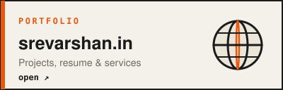</a>
  <a href="https://youtube.com/@SreVarshanAI">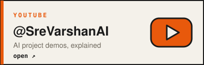</a>
  

## 01 · Patent

<a href="https://github.com/Srevarshan05/Banana-Weevil-detection-ML">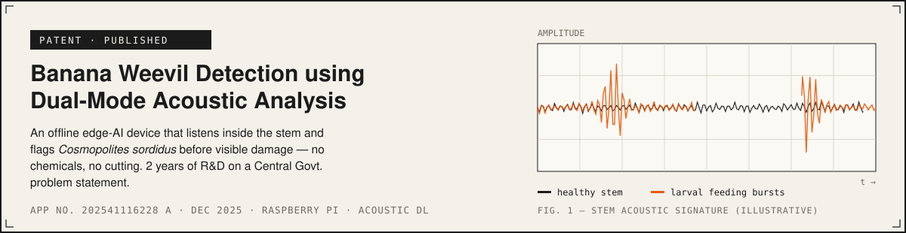</a>

## 02 · Projects & work

<table>
<tr>
<td width="44%" valign="middle"><a href="https://github.com/Srevarshan05/textlens">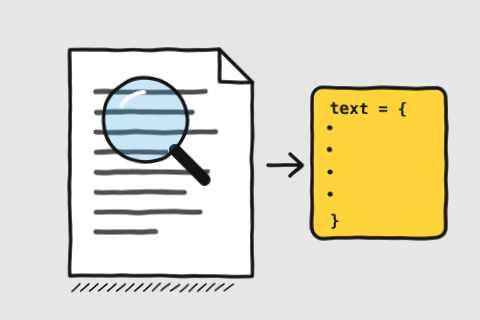</a></td>
<td width="56%" valign="top">

### [TextLens](https://github.com/Srevarshan05/textlens)
**A Python library that reads text out of images and PDFs.**

Give it a scanned page, a photo or a PDF and it hands back clean text. You choose the reader: a classic OCR engine or a modern vision-language model. TextLens handles the hard parts: batching pages on the GPU, caching results, and serving it all as an API. The same code runs on a Raspberry Pi or a big GPU server.

**Impact →** Published on PyPI. Anyone can `pip install textlens-ocr`.

`Python` `Vision-language models` `FastAPI` `CUDA`

</td>
</tr>
<tr>
<td width="56%" valign="top">

### [AgroCare](https://github.com/Srevarshan05/Agro-s-Care-IITM)
**Live crop-health alerts for cotton farmers, even with no internet.**

A soil probe we built measures pH, nutrients (NPK) and moisture. Readings travel by long-range LoRa radio to a nearby hub, so the field doesn't need internet. A drone photographs the crop, a CNN spots disease on the leaves, and an LLM tells the farmer what to do next in plain language.

**Impact →** 1st prize at Spectrum '25 (VIT Chennai). Top 8 nationally at IIT Madras, then selected for IIM product mentorship.

`ESP32` `LoRa` `CNN` `Drone + SLAM` `LLM`

</td>
<td width="44%" valign="middle"><a href="https://github.com/Srevarshan05/Agro-s-Care-IITM"></a></td>
</tr>
<tr>
<td width="44%" valign="middle"><a href="https://github.com/Srevarshan05/env-hacks-2026"></a></td>
<td width="56%" valign="top">

### [Algae Air Purifier](https://github.com/Srevarshan05/env-hacks-2026)
**A living air filter that reports its own air quality.**

Thin layers of algae absorb CO₂ and pollutants as air passes through. A sensor (BME680) measures the air every 10 seconds and sends the reading to the cloud over Wi-Fi or LoRa. A serverless AWS backend stores the data, and a live web dashboard shows how much cleaner the air is getting.

**Impact →** Built for AWS Environmental Hacks '26 and running live on AWS.

`ESP32` `AWS Lambda` `DynamoDB` `React`

</td>
</tr>
<tr>
<td width="56%" valign="top">

### [ACAS DHRISTI](https://github.com/Srevarshan05/Aadhaar-Capacitory-Advisory-System-AI)
**Predicts which Aadhaar centres will be overloaded next week.**

Long queues at Aadhaar centres are usually predictable. This system learns from past footfall and forecasts the load at every centre 7 days ahead. When a centre is about to be overwhelmed, it automatically sends an advisory (through n8n workflows) so officials can add staff or redirect people *before* the queue forms.

**Impact →** Covers all 173,225 Aadhaar centres in Tamil Nadu.

`Time-series forecasting` `Python` `n8n`

</td>
<td width="44%" valign="middle"><a href="https://github.com/Srevarshan05/Aadhaar-Capacitory-Advisory-System-AI">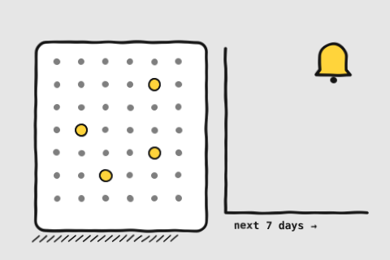</a></td>
</tr>
<tr>
<td width="44%" valign="middle"><a href="https://github.com/Srevarshan05/nutriminds-ai"></a></td>
<td width="56%" valign="top">

### [NutriMinds AI](https://github.com/Srevarshan05/nutriminds-ai)
**Point your phone at a food label and learn if it's right for *you*.**

A vision model reads the ingredients and nutrition table from a photo. Product data from Open Food Facts fills in the gaps. A fine-tuned Mistral-7B explains it in simple words, and clinical rules flag anything risky for your health profile, such as too much sugar for a diabetic.

**Impact →** Turns an unreadable label into a personal yes / no in one photo.

`Mistral-7B (fine-tuned)` `Vision OCR` `Open Food Facts`

</td>
</tr>
<tr>
<td width="56%" valign="top">

### [Aura-Sync](https://github.com/Srevarshan05/Aura-Sync-Real-Time-Editor)
**Google Docs, but for programming Arduino boards together.**

Several people open the same Arduino sketch in the browser and edit it live, seeing each other's changes instantly. When it's ready, the code compiles safely in the cloud inside Docker and can be flashed to the board. An AI assistant helps with the code along the way.

**Impact →** Under 100 ms live sync, built before Arduino launched its own cloud editor.

`Node.js` `WebSockets` `Docker` `GCP`

</td>
<td width="44%" valign="middle"><a href="https://github.com/Srevarshan05/Aura-Sync-Real-Time-Editor">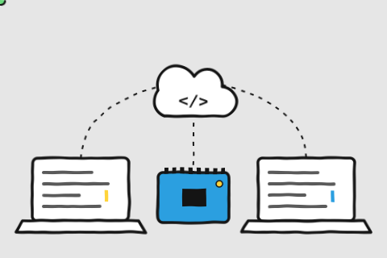</a></td>
</tr>
</table>

<b>More projects</b>

 

| Project | What it does | Built with |
|---|---|---|
| [RAG Pipeline From Scratch](https://github.com/Srevarshan05/RAG-Pipeline-From-Scratch) | Ask questions about your documents and get answers that cite them | ChromaDB · Groq |
| [Xenia CRM](https://github.com/Srevarshan05/xenia-crm-frontend) | Retail CRM that writes campaigns, calls customers by AI voice and predicts churn | ElevenLabs · Llama 3.3 · FastAPI |
| [VocSense](https://github.com/Srevarshan05/VocSense-Edge-AI-Olfactory-Intelligence-System) | An "electronic nose" that identifies gases on a tiny chip | ESP32 · Random Forest |
| [Voice biometrics + deepfake detection](https://github.com/Srevarshan05/voice-biometric-authentication-and-deepfake-detection) | Logs you in by voice and rejects AI-cloned voices | Audio deep learning |
| [GPU batch academic OCR](https://github.com/Srevarshan05/gpu-accelerated-batch-academic-ocr-pipeline) | Digitises large batches of academic documents on the GPU | CUDA · VLM |
| CocoSense | Autonomous drone that maps coconut plantations | Jetson Orin Nano · LiDAR · SLAM |

## 03 · From sensor to production


## 04 · Internship & research experience

<table>
<tr>
<td width="62%" valign="top">

**Intelligent System Developer** · [EmedLogix](https://enroll.pmslogix.com) 
Dec 2025 – Jun 2026 · Remote · US health-tech SaaS

- Built a **Text-to-SQL agent**: staff ask questions in English and get answers from the PostgreSQL database on AWS RDS.
- Built an **OCR pipeline (Qwen2.5-VL-7B)** that reads provider documents and fills forms automatically.
- Automated tracking of 60+ documents per provider, with alerts 30 days before they expire.
- Integrated CAQH + NPI APIs, added Azure Entra sign-in, and shipped the beta on AWS.

**Student Researcher** · SRM R&D 
Central Govt. problem statement · 2 years

- Designed an offline edge-AI device that **hears weevil larvae inside banana stems**. It led to a published patent (section 01).

**AI/ML Intern** · Microsoft × Edunet Foundation 
Jun – Aug 2024 · Remote

- Capstone "AI Nose": gas sensors on an ESP32 plus a Random Forest model that identifies smells, with a live dashboard.

</td>
<td width="38%" valign="middle" align="center">

</td>
</tr>
</table>

## 05 · Achievements & stages

<table>
<tr>
<td width="38%" valign="middle" align="center">

</td>
<td width="62%" valign="top">

| Stage | Result |
|---|---|
| Spectrum '25 Hackathon, VIT Chennai | 🥇 **1st place** |
| SolveX AI Challenge | 🥇 **1st place** |
| NAF Uzhavu Hackathon, IIT Madras | **Top 8 nationally** → IIM mentorship |
| Amazon ML Challenge 2026 | Top 1,000 of 11,000+ teams |
| IIC Regional Meet 2025 | Best Innovation (South) |
| Physical AI & Robotics, SRM × Gifu Univ. | Best Presentation |

21 certifications, including Anthropic (MCP), NVIDIA (Jetson Nano), Oracle (OCI AI Foundations), Stanford × DeepLearning.AI and Google Cloud.

</td>
</tr>
</table>

## 06 · Telemetry

  
  

<picture>
  <source media="(prefers-color-scheme: dark)" srcset="https://raw.githubusercontent.com/Srevarshan05/Srevarshan05/output/github-snake-dark.svg"/>
  <source media="(prefers-color-scheme: light)" srcset="https://raw.githubusercontent.com/Srevarshan05/Srevarshan05/output/github-snake.svg"/>
  
</picture>

## 07 · Let's build something

Building something hard in AI — research, a production system, or a problem nobody has cleanly solved? **[srevarshan9600622@gmail.com](mailto:srevarshan9600622@gmail.com)**, or find me here:

  
  
  

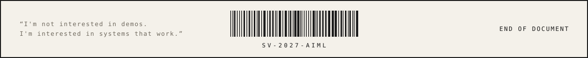

